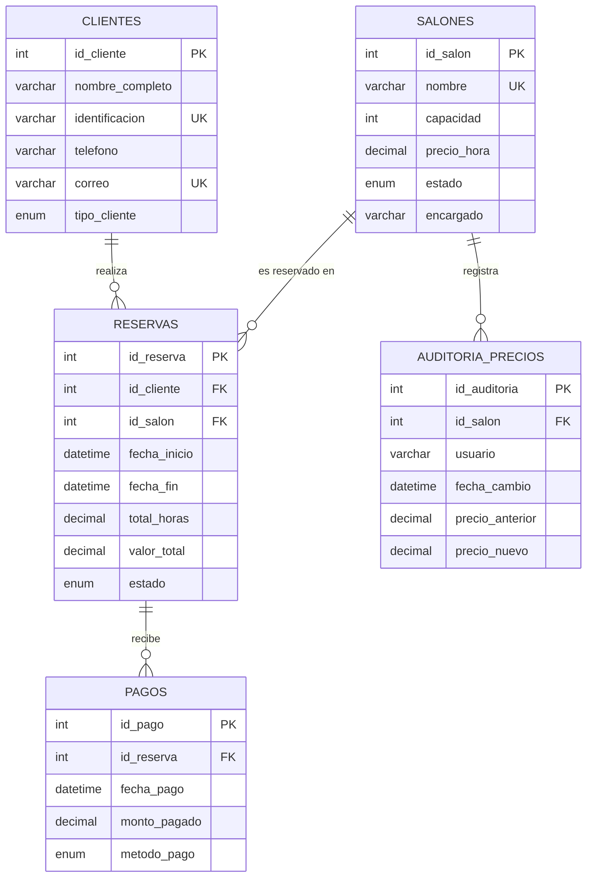

# Diagrama entidad-relación – Eventos Premier S.A.S.

## Diagrama



## Modelo relacional

```
clientes(id_cliente PK, nombre_completo, identificacion UNIQUE, telefono, correo UNIQUE, tipo_cliente)
salones(id_salon PK, nombre UNIQUE, capacidad, precio_hora, estado, encargado)
reservas(id_reserva PK, id_cliente FK→clientes, id_salon FK→salones,
         fecha_inicio, fecha_fin, total_horas, valor_total, estado)
pagos(id_pago PK, id_reserva FK→reservas, fecha_pago, monto_pagado, metodo_pago)
auditoria_precios(id_auditoria PK, id_salon FK→salones, usuario,
                  fecha_cambio, precio_anterior, precio_nuevo)
```

## Cardinalidades

| Relación | Cardinalidad | Explicación |
|---|---|---|
| Cliente – Reserva | 1:N | Un cliente puede tener muchas reservas; cada reserva es de un solo cliente |
| Salón – Reserva | 1:N | Un salón puede tener muchas reservas; cada reserva es de un solo salón |
| Reserva – Pago | 1:N | Una reserva puede tener varios pagos (por ejemplo, abonos) |
| Salón – Auditoría de precios | 1:N | Un salón puede tener muchos cambios de precio registrados |
| Cliente – Salón | N:M | Se resuelve con la tabla `reservas`, que actúa como tabla intermedia |
